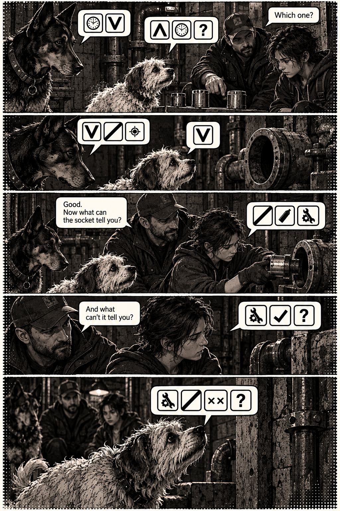
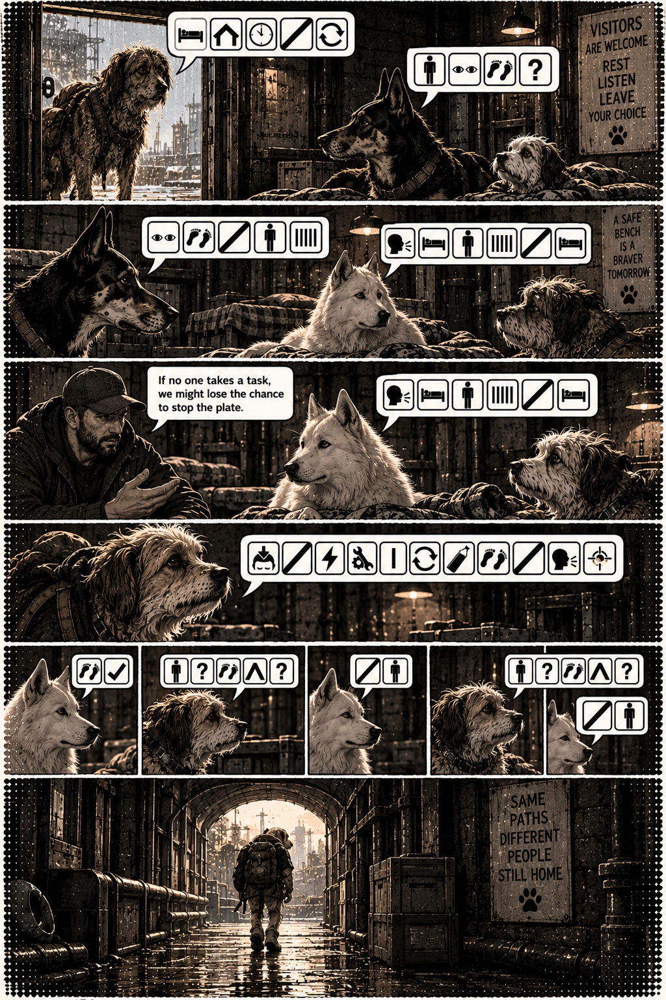
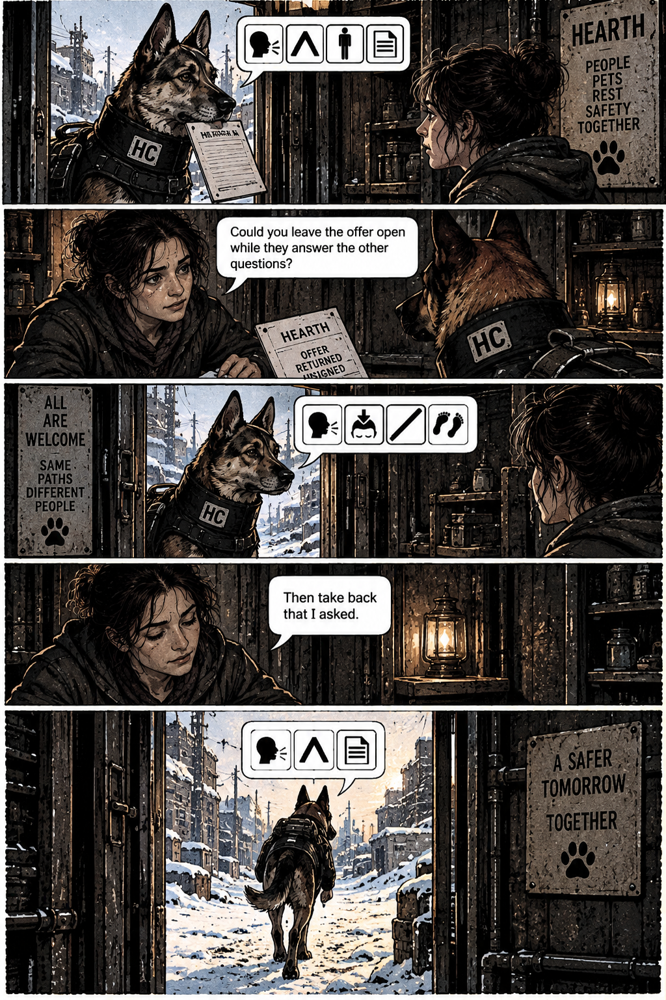
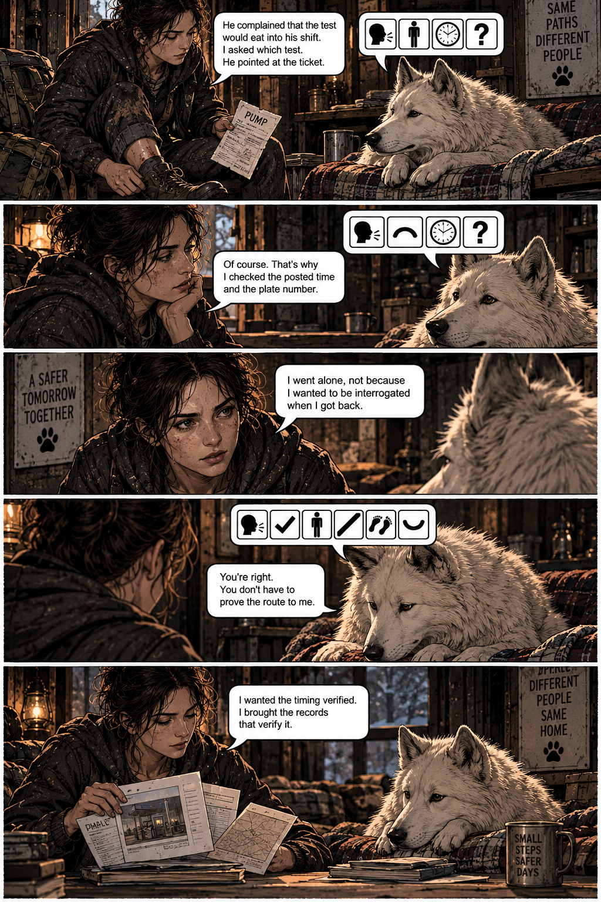

# Pictiq Editorial Case 003 — Good Dog, Bad District

**PUBLISHED / AMAZON LIVE — first verified live observation: 2026-09-30**

This research record preserves owner-designated published assets and publication evidence. It does not create a production-site case page.

## Identity and publication evidence

- **Book:** Good Dog, Bad District: A Darkly Comic System Apocalypse LitRPG
- **Series:** Good Dogs of the Apocalypse — Book 2
- **Book-facing author:** Sminx Jonahtan J.
- **Amazon author:** Sminx Jonahtan
- **Use type:** `PUBLISHED FICTION / IN-WORLD INTERSPECIES LANGUAGE`
- **Kindle:** LIVE — B0HLJ9VMWB — $4.99 USD at observation
- **Paperback:** LIVE — B0HLLKRHRW — $18.99 USD at observation
- **Series:** LIVE on the supplied KDP Bookshelf screenshot

The [publication record](GOOD_DOG_BAD_DISTRICT_PICTIQ_PUBLICATION_V1.json) preserves the two exact owner-supplied KDP marketplace redirect links. No unverified public storefront URL or ISBN is invented. The screenshot's submission dates (Kindle 2026-09-29; paperback 2026-09-30) are not asserted publication dates. LIVE status is recorded from owner-supplied evidence; no independent storefront or interior inspection is claimed.

[Retailer LIVE evidence](assets/retailer-evidence/kdp-live-2026-09-30.png)

## Narrative language contract

| Communication | Required channel | Scope |
| --- | --- | --- |
| Dog direct speech | Pictiq | Good Dogs series canon |
| Human direct speech | English | Good Dogs series canon |
| System / ordinary human-readable interfaces | English / established book typography | Good Dogs series canon |

Pictiq performs a narrative dialogue function: the visual language belongs to dogs and is not ordinary English shared automatically by human characters. English human dialogue may coexist with Pictiq bubbles in the same comic. The supplied GD2-C01 semantic list identifies eight dog turns; the final image also contains English human bubbles. These are distinct layers of evidence, not a licence to reassign any supplied dog turn to a human. No exact panel/turn mapping is asserted.

## Published comic gallery — one grouped case

### GD2-C01

Contextual dialogue around a socket, fitting and uncertainty. [Composer production evidence](assets/composer-sources/composer-01.png).

### GD2-C02

Canine dialogue about shelter, tasks and freedom to leave, alongside human English dialogue. [Composer production evidence](assets/composer-sources/composer-02.png).

### GD2-C03

A courier's constrained authority, alongside a human response in English. [Composer production evidence](assets/composer-sources/composer-03.png).

### GD2-C04

Canine questions about timing and uncertainty, alongside human English dialogue. [Composer production evidence](assets/composer-sources/composer-04.png).

All four originals are classified `PUBLISHED_USE_CASE_ASSET` and `PICTIQ_IN_CONTEXT`. The [asset manifest](GOOD_DOG_BAD_DISTRICT_PICTIQ_ASSET_MANIFEST_V1.json) records exact bytes, dimensions, SHA-256 and original paths for four comics, four Composer screenshots, retailer evidence, and the preserved owner brief. Interior page numbers and book-file hashes remain unavailable.

## Semantic source and provenance

The [dialogue ledger](GOOD_DOG_BAD_DISTRICT_PICTIQ_DIALOGUE_LEDGER_V1.json) preserves 24 supplied semantic turns across four scenes. It links scene-level Composer evidence and final art without reconstructing historical glyph IDs, per-turn coordinates, versions, or final panel assignments. [Owner brief](evidence/owner-ingest-brief.txt) is preserved verbatim.

**PICTIQ VISUAL CHANNEL: VERIFIED BY OWNER REVIEW** — recorded owner review, not a new independent fidelity acceptance.

**EXACT RETROSPECTIVE SEMANTIC PROVENANCE: PARTIAL / NOT FULLY MACHINE-VERIFIED.** The owner accepted this limitation for Book Two publication. Screenshots do not upgrade it to FULL.

Wrench, Learner and Pixel are dogs per the Book Two brief; Mriya is explicitly a dog, and Atlas/Mriya are canine in the existing Book One case. The High Collars courier's Pictiq channel follows the supplied canonical language assertion. Vetch's species is not explicitly stated in the supplied brief: its attribution remains UNRESOLVED pending owner/canon confirmation, not inferred from generated appearance.

The Composer images are historical batch evidence, not proven exact per-turn final source. Visible differences exist: GD2-C02's first screenshot row has three tiles while the final opening bubble has five; GD2-C03's second screenshot row begins with a visually different tile than the final corresponding speech bubble; GD2-C04 screenshot rows differ in tile order/count from final bubbles. No token-ID crosswalk or semantic diagnosis is inferred from these differences. Owner visual approval and exact source-copy fidelity are separate claims; this ingest preserves the discrepancy rather than repairing history.

## Learning and limits

See [workflow learnings and future Composer evidence contract](GOOD_DOG_BAD_DISTRICT_PICTIQ_LEARNING_V1.md) and [nothing / zero / absence product issue](VOCABULARY_GAP_NOTHING_ZERO_ABSENCE_V1.md).

Book Two documents production use across four sequential scenes in owner-reported published Kindle and paperback editions, with manuscript-constrained meanings and human-approved Composer workflow. It does not establish reader comprehension, sales, adoption, commercial outcomes, exact retrospective glyph fidelity, or a new protocol capability.

## Series continuation

**NEXT PUBLISHED CASE / SERIES CONTINUATION** of [Case 002 — Good Dog, Bad System](../good-dog-bad-system/GOOD_DOG_BAD_SYSTEM_PICTIQ_CASE_V1.md). Book One's existing PREPUBLICATION record and weaker per-turn provenance are unchanged. Book Two's retailer evidence does not establish Book One's publication status. No book files, Core, lexicon, mappings, icons, grammar, Composer, Renderer, Dictionary baseline or production site were changed.
